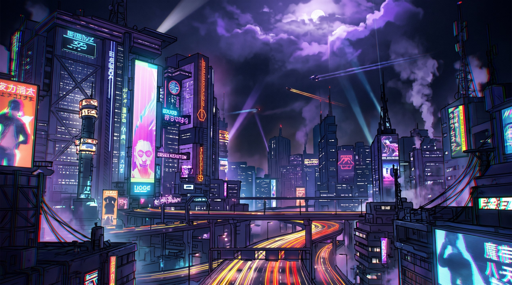

<!-- ══════════════ HEADER ══════════════ -->
<p align="center">
  
</p>

<h1 align="center" style="text-shadow: 0 0 10px #ff00ff, 0 0 20px #00ffff;">⚡ Welcome to my profile ⚡</h1>

<p align="center">
  <a href="https://git.io/typing-svg">
    
  </a>
</p>

<p align="center">
  <a href="https://github.com/indy0x?tab=followers">
    
  </a>
  &nbsp;
  <a href="https://github.com/indy0x?tab=repositories">
    
  </a>
  &nbsp;
  
</p>


<!-- ══════════════ ABOUT ME ══════════════ -->
<h2 align="center">🌌 ⟨ About me ⟩</h2>

<div align="center">
<table>
  <tr>
    <td width="65%" valign="middle">

```yaml
whoami:
  name: Indy (Bastien)
  role: 2nd Year Cybersecurity Student
  status: Looking for an apprenticeship (Sept. 2027)

personal:
  - 🛠️ currently_building: My personal homelab
  - 🌍 offline_hobbies: Sport, music & travel
  - 🎮 video_games: Counter-Strike 2, League of Legends, Clair Obscur: Expedition 33

focus:
  - 🛡️ Blue Team: SOC, CTI (Cyber Threat Intelligence) & Digital Forensics
  - ⚙️ DevOps & Sysadmin: Infrastructure as Code & Automation
  - 🧠 AI & Security: Applied Mathematics, Machine Learning & Deep Learning
  - 🔌 Hardware/Embedded: Tinkering with fun DIY mini-projects & microcontrollers

setup: Debian + KDE Plasma 6
devise: "Hack the planet ⚡"
```

  </td>
    <td width="35%" align="center" valign="middle">
      
    </td>
  </tr>
</table>
</div>

<!-- ══════════════ TECH STACK ══════════════ -->
<h2 align="center">🚀 ⟨ Tech Stack ⟩</h2>

<p align="center">
  <a href="https://skillicons.dev">
    
  </a>
  <br/>
  <a href="https://skillicons.dev">
    
  </a>
</p>


<!-- ══════════════ STATS & EXPERTISE ══════════════ -->
<h2 align="center">👾 ⟨ Stats & Expertise ⟩</h2>

<p align="center">
  
  &nbsp;
  <a href="https://profile.hackthebox.com/profile/01a11653-3350-70e1-9a7b-b3fc5850f354">
    
  </a>
</p>

<!-- ══════════════ ACTIVITY ══════════════ -->
<h2 align="center">🌙 ⟨ Activity ⟩</h2>

<p align="center">
  
</p>

<p align="center">
  
</p>

<!-- ══════════════ SNAKE ══════════════ -->
<!-- Generated by .github/workflows/snake.yml (branch "output") -->
<h2 align="center">🐍 ⟨ Contribution Snake ⟩</h2>

<p align="center">
  <picture>
    <source media="(prefers-color-scheme: dark)" srcset="https://raw.githubusercontent.com/indy0x/indy0x/output/github-snake-dark.svg" />
    <source media="(prefers-color-scheme: light)" srcset="https://raw.githubusercontent.com/indy0x/indy0x/output/github-snake.svg" />
    
  </picture>
</p>


<!-- ══════════════ CONTACT ══════════════ -->
<h2 align="center">📡 ⟨ Contact ⟩</h2>

<p align="center">
  <a href="https://www.linkedin.com/in/bastien-leautey-451a77384/"></a>
  <a href="mailto:bastienleautey2@gmail.com"></a>
  <a href="https://discordapp.com/users/730507745962361023"></a>
  <a href="https://steamcommunity.com/profiles/76561198998737672/"></a>
</p>

<!-- ══════════════ FOOTER ══════════════ -->
<p align="center">
  
</p>
